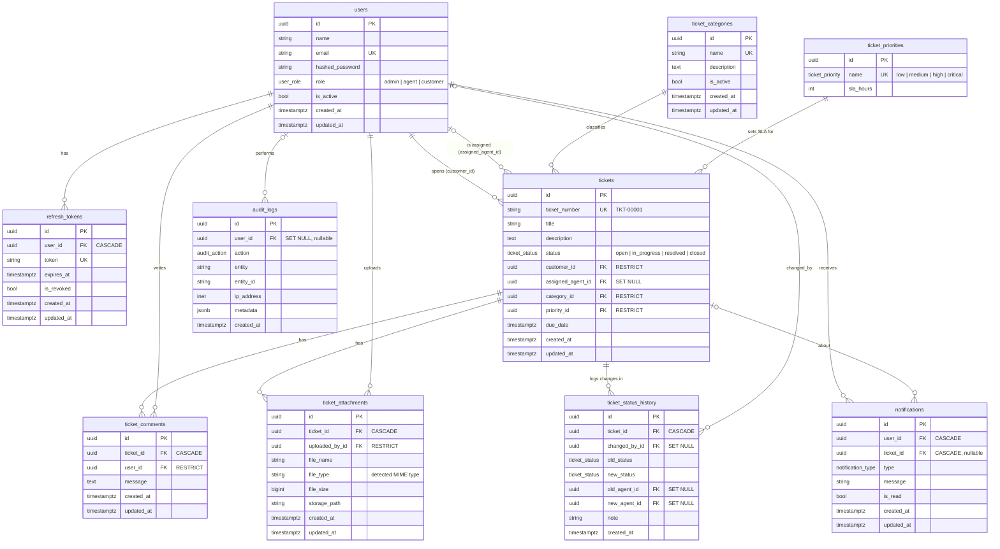

# Database design (ER diagram)

**Delete rules in one sentence:** core ticket data (customer, category, priority, authors, uploaders) is protected with `RESTRICT`; things that only make sense alongside their parent (comments, attachments, history, notifications, refresh tokens) are removed with `CASCADE`; optional references (assigned agent, audit/history actor) become `NULL` with `SET NULL`.